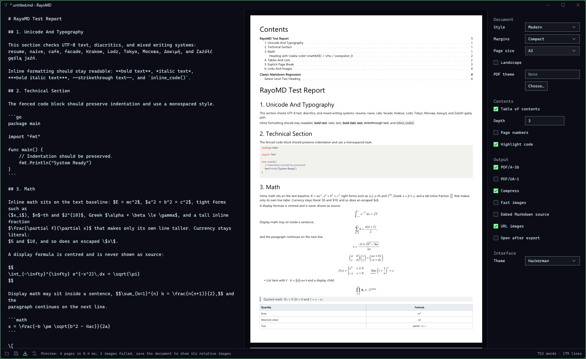
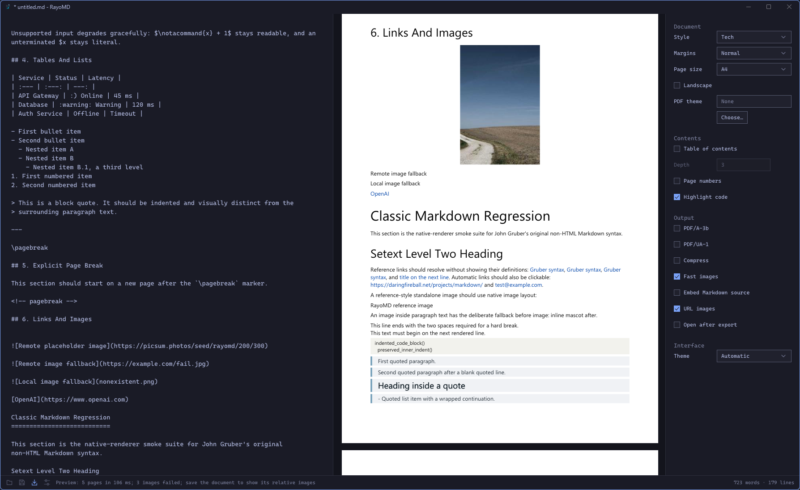
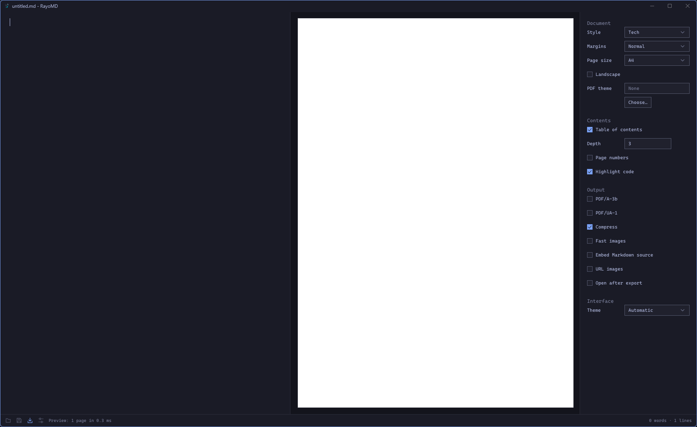

<a id="readme-top"></a>

<div align="center">


# RayoMD GUI

**Markdown on the left, the real PDF on the right, updated as you type.**<br>
A native desktop app for Omarchy, Wayland desktops and Windows. No browser. No Qt. No Electron.

<a href="https://github.com/Butterski/rayomd-gui/releases/latest"></a>
<a href="LICENSE"></a>
<a href="https://omarchy.org"></a>

<a href="https://github.com/Butterski/rayomd-gui/actions/workflows/ci.yml"></a>
<a href="https://github.com/Butterski/rayomd-gui/actions/workflows/release.yml"></a>
<a href="https://github.com/Butterski/rayomd-gui/actions/workflows/codeql.yml"></a>


[**Download**](https://github.com/Butterski/rayomd-gui/releases/latest) ·
[Quick start](#quick-start) ·
[Features](#features) ·
[Performance](#performance) ·
[Building](#building)



</div>

> [!NOTE]
> The repository is private while the app is prepared for its first public release. Each version
> is built for Linux, Arch Linux and Windows and published as a
> [release](https://github.com/Butterski/rayomd-gui/releases/latest).

RayoMD GUI is the desktop app of [RayoMD](https://github.com/Butterski/rayomd): write Markdown,
see the PDF as you type, export it. It runs on its own small toolkit, drawn by its own software
renderer: on Linux the program needs only the C library, on Windows only system DLLs. The preview
is not an imitation of the PDF but the PDF itself, the bytes the engine just built in memory,
drawn by the app's own PDF renderer.

## Highlights

<table>
<tr>
<td width="33%" valign="top">

### Live
A keystroke reaches the preview in about **4 ms** in `tester.md`. No waiting timer, and a slow
build never holds up typing.

</td>
<td width="33%" valign="top">

### The real PDF
The preview shows the PDF Export writes, **0.4/255** from poppler's rendering on average over 45
test pages.

</td>
<td width="33%" valign="top">

### Omarchy native
Follows the current **Omarchy** theme and font as they change, in the look of Omarchy's own
apps. 23 Omarchy themes are built in for other desktops.

</td>
</tr>
<tr>
<td valign="top">

### Small
A **1.4 MB** Linux download and a 1.7 MB Windows download. No browser engine, toolkit or runtime
to install.

</td>
<td valign="top">

### Every export option
Styles, margins, page sizes, PDF themes, tables of contents, page numbers, code colours,
**PDF/A-3b** and **PDF/UA-1**.

</td>
<td valign="top">

### Hardened
Untrusted documents, images and fonts are read within work and memory limits; fuzzed, and built
with the platforms' exploit mitigations.

</td>
</tr>
</table>

## Quick start

While the repository is private, download the assets with a logged-in
[GitHub CLI](https://cli.github.com) (`gh auth login`) or from the
[release page](https://github.com/Butterski/rayomd-gui/releases/latest).

<details open>
<summary><b>Omarchy and Arch Linux</b>: the package</summary>

```sh
gh release download v1.1.1 --repo Butterski/rayomd-gui --pattern '*.pkg.tar.zst'
sudo pacman -U rayomd-gui-1.1.1-1-x86_64.pkg.tar.zst
rayomd-gui notes.md
```

It installs the program, its menu entry and its icons.

</details>

<details>
<summary><b>Other Linux</b>: glibc 2.34 or newer and a Wayland desktop</summary>

```sh
gh release download v1.1.1 --repo Butterski/rayomd-gui --pattern '*-linux-x64.tar.gz'
tar -xzf rayomd-gui-1.1.1-linux-x64.tar.gz
./rayomd-gui-1.1.1-linux-x64/rayomd-gui notes.md
```

For the application menu, put the program on your `PATH` and copy its menu entry and icons:

```sh
install -Dm755 rayomd-gui-1.1.1-linux-x64/rayomd-gui ~/.local/bin/rayomd-gui
cp -r rayomd-gui-1.1.1-linux-x64/share/. ~/.local/share/
```

</details>

<details>
<summary><b>Windows</b>: <code>rayomd-gui.exe</code></summary>

Download `rayomd-gui-1.1.1-windows-x64.zip` from the
[release page](https://github.com/Butterski/rayomd-gui/releases/latest), unpack it and
start `rayomd-gui.exe`, or drop a Markdown file on it.

</details>

<details>
<summary><b>Build from source</b></summary>

GCC or Clang and CMake 3.21 or newer, x86-64. The engine is the `external/rayomd` submodule:

```sh
git clone --recursive https://github.com/Butterski/rayomd-gui.git && cd rayomd-gui
cmake --preset linux-release && cmake --build --preset linux-release
build/linux-release/src/rayomd-gui notes.md
```

Windows and the tests: [Building](#building).

</details>

| Package | Size | For |
|---|---:|---|
| `rayomd-gui-<version>-1-x86_64.pkg.tar.zst` | 1,477 KB | Omarchy and Arch Linux: `pacman -U` |
| `rayomd-gui-<version>-linux-x64.tar.gz` | 1,383 KB | Linux with glibc 2.34 or newer: the program, its menu entry and icons |
| `rayomd-gui-<version>-windows-x64.zip` | 1,678 KB | Windows x64: one `rayomd-gui.exe` |

<p align="right"><a href="#readme-top">back to top ↑</a></p>

## Features

### Editor and preview

The editor is on the left, the PDF on the right. A change goes to the engine at the end of the
frame that made it, and what you type while a build runs goes into the next one. Pages that did
not change keep their images, and a page with a large picture draws again in about 2 ms.

The two panes stay together. A click in the editor shows its line in the preview, marked for a
moment by a bar beside it, and a double click on a page puts the caret on the Markdown line that
made it. With *Sync scrolling* (on by default, in the options' Interface section), scrolling
either pane brings the other to the same place.

Typing helps with the Markdown. Enter continues a list or a quote (`- `, `1. ` counting up,
`- [ ] `, `> `, at the same indentation) and Enter on an empty item ends it; Tab and Shift+Tab
indent and outdent a list item. `Ctrl+I`, or the footer's insert button, opens a list at the caret:
page break, table of contents, table, callout (with GitHub's five types), Mermaid flowchart and
sequence diagram, math block, code block, front matter and rule, each on lines of its own with the
caret where you type next. Typing ```` ``` ```` at the start of a line lists the fence languages
the PDF highlights (and `mermaid`, `math`), `> [!` the callout types and, with the Obsidian
dialect, `[[` the document's headings; type to filter, Enter or a click picks, Escape closes. An
image dropped on a saved document (PNG, JPEG or SVG) is copied into an `images` folder beside it,
never over an existing file, and linked at the caret.



| Keys | Action |
|---|---|
| `Ctrl+O` / `Ctrl+N` | Open / new document |
| `Ctrl+S` / `Ctrl+Shift+S` | Save / save as |
| `Ctrl+E` / `Ctrl+Shift+E` | Export the PDF / export to another file |
| `Ctrl+,` | Show or hide the options |
| `Ctrl+I` | Insert a page break, table, callout, diagram, math, code, front matter… at the caret |
| `Enter` / `Shift+Enter` | New line, continuing a list or quote / plain new line |
| `Tab` / `Shift+Tab` | Indent / outdent a list item (elsewhere `Tab` inserts a tab) |
| `Up`, `Down`, `Enter`, `Esc` | Move in, pick from, close the list at the caret |
| `Ctrl+=`, `Ctrl+-`, `Ctrl+0` | Editor text size up, down, back (`Ctrl+0` also resets the preview zoom) |
| `Ctrl+wheel` | Zoom the preview |
| Double click on a page | Put the editor's caret on the line it shows |
| `Ctrl+Q` | Quit |

Every action that would lose unsaved text asks first. Files dropped on the window open: `.md`,
`.markdown`, `.txt` and `.pdf`; `.png`, `.jpg`, `.jpeg` and `.svg` go into the document's
`images` folder (save a new document first). A reversible RayoMD PDF, exported with its Markdown
source embedded, opens as that source, checked byte for byte.

### Export options

The engine's export options, in the panel on the right (`Ctrl+,`):



- **Document:** the Markdown dialect (GitHub's, or Obsidian's: callouts with titles,
  `==highlights==`, `%%comments%%`, `[[wiki links]]` and `![[images]]`), style (Elegant, Modern,
  Tech), margins (also custom), page size (A4, A3, A5, Letter, Legal or custom, in landscape too)
  and a PDF theme file: company fonts, colours, header, footer and cover page.
- **Contents:** a table of contents with its depth, headings numbered 1, 1.1, 1.1.1 to a depth,
  a new page before each heading of the top levels, page numbers, code coloured as on GitHub.
- **Output:** PDF/A-3b, PDF/UA-1, compression, faster image encoding, the Markdown source
  embedded, URL images (Windows), opening the PDF after export.

The options are remembered, with the window's size and the editor's text size.

### Themes

On Omarchy, *Follow Omarchy* takes the current theme's colours, its `shell.toml` sizes and the
Omarchy font, and follows a theme switch as it happens. Elsewhere *Automatic* follows the
system's light or dark mode (Tokyo Night or Catppuccin Latte), or you pick one of the 23 Omarchy
themes: Catppuccin, Catppuccin Latte, Ethereal, Everforest, Flexoki Light, Gruvbox, Hackerman,
Kanagawa, Last Horizon, Lumon, Lupine, Matte Black, Miasma, Nord, Osaka Jade, Retro 82, Ristretto,
Rose Pine, Solitude, Starship, Tokyo Night, Vantablack and White.

### Desktop integration

System file dialogs (the desktop portal on Linux, the common dialogs on Windows), the clipboard,
input methods such as fcitx5, Compose keys, fractional scaling and server-side decorations where
the compositor offers them. Saves replace the file atomically and keep its permissions. On Linux,
if the compositor goes away, unsaved text is written to a recovery copy first.

`rayomd-gui --snapshot out.png notes.md` writes the first complete frame to a PNG and prints
where startup's time went; the end-to-end tests run it on headless compositors.

<p align="right"><a href="#readme-top">back to top ↑</a></p>

## Performance

Measured on 2026-10-15 and 2026-10-16: on Linux with an AMD Ryzen 5 PRO 4650GE in an Arch Linux
container, pinned to six cores, on headless Wayland compositors; on Windows on GitHub's runners.

| Measure | Result |
|---|---:|
| Keystroke to the edited page's preview, `tester.md` (5 KB, 5 pages), median / p99 | **4.1 / 5.1 ms** |
| The same, 8 copies (42 KB, 40 pages) | 5.9 / 7.5 ms |
| The same, 70 copies (364 KB, 350 pages) | 21.6 / 24.8 ms |
| The same, 700 copies (3.6 MB, 3,500 pages) | 192 / 206 ms |
| One keystroke in a 1 MiB document, editor and drawing, median | 0.31 ms |
| A frame while the preview / the editor scrolls, 1788×1097 window, 40 pages, median / p99 | 3.4 / 4.6 ms, 3.2 / 4.0 ms |
| Scrolling frames a second on Windows runners, before / now | 32 / 64 (every refresh of their 64 Hz display) |
| Page 1 of `tester.md` at 1,200 px, first time / with warm caches | 6.8 / 1.3 ms |
| Start to first frame / to the preview of `tester.md`, Linux | 12 / 37 ms |
| The same on Windows runners | 15–26 / 74–161 ms |

A keystroke used to wait 80 ms for typing to pause (84 ms in `tester.md`); a build that is no
longer wanted is now abandoned, so quitting during the 3.6 MB build takes 25 ms. On Windows,
animated scrolling used to wait on a 16 ms timer, which the system clock's 15.6 ms ticks turn
into 31 ms; frames now come at each refresh of the display. The tests `bench.preview_latency`,
`bench.typing` and `bench.scroll` print these numbers, `win32.frame_pacer` the Windows frame
rate; `--snapshot` prints the startup ones.

## Boundaries

> [!NOTE]
> The PDFs are RayoMD's: its fast Markdown subset, not Pandoc's. What the engine does and does
> not render is in its [README](https://github.com/Butterski/rayomd#features) and
> [Native Markdown Support](https://github.com/Butterski/rayomd/wiki/Native-Markdown-Support).

- The editor is plain text, without Markdown highlighting; the preview shows the formatting.
- Linux needs a Wayland desktop; there is no X11 backend. x86-64 only.
- URL images are fetched on Windows only: the Linux program links no libcurl, so they show their
  alt text there.
- The interface font is the system's: Omarchy's monospace font on Linux, Cascadia Mono or
  Consolas on Windows.

<p align="right"><a href="#readme-top">back to top ↑</a></p>

## Building

The engine is the `external/rayomd` submodule; clone with `--recursive`, or run
`git submodule update --init` after cloning. Engine changes go to the `rayomd` repository
first; the submodule then moves to that commit.

On Linux (GCC or Clang, CMake 3.21 or newer):

```sh
cmake --preset linux-release && cmake --build --preset linux-release && ctest --preset linux-release
```

On Windows, in an MSYS2 UCRT64 shell:

```sh
cmake --preset windows-mingw && cmake --build --preset windows-mingw
build/windows/tests/rayomd-gui-tests.exe
```

`tests/e2e/run_compositor.sh weston|sway` runs the app on a headless compositor and checks its
snapshot; ctest runs both when weston and sway are installed. On Arch, `linux/pkgbuild` builds a
package of the working tree: `cd linux/pkgbuild && makepkg -f`.

A push to `main` that changes `VERSION` runs the Release workflow
(`.github/workflows/release.yml`), as in RayoMD. It builds the Linux binary on Ubuntu 22.04 (so
it runs on glibc 2.34 or newer), the Arch package and the Windows executable, and publishes them
as the release `v<VERSION>`, tagged at that commit. A tag `v<VERSION>` or a manual run of the
workflow publishes the same; other pushes publish nothing (CI builds and tests them).

## Contributing

Read [`AGENTS.md`](AGENTS.md) first: the toolkit's conventions, the rule that the Linux program
needs nothing beyond the C library, the limits every reader of outside data keeps, and how to
build, test and fuzz.

## License

Apache License 2.0; see [`LICENSE`](LICENSE). [`NOTICE`](NOTICE) lists the third-party
material, among it the Omarchy theme palettes and icon paths (MIT, `third_party/omarchy/`).

<p align="right"><a href="#readme-top">back to top ↑</a></p>
